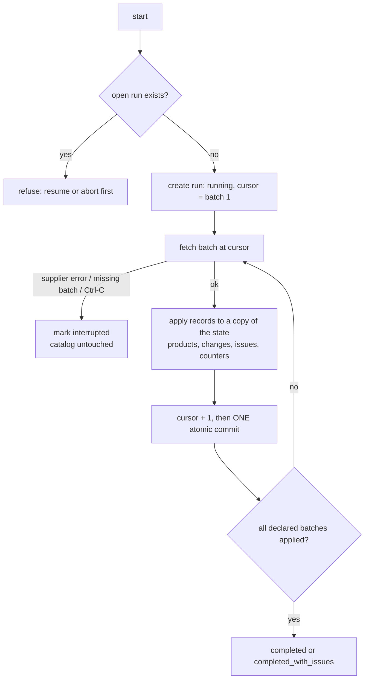
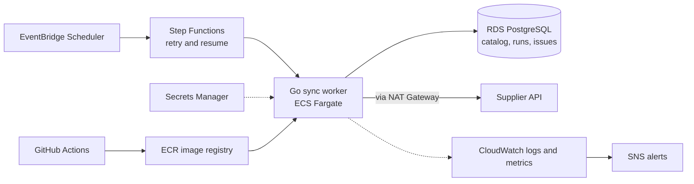

# Supplier Catalog Sync

A command-line tool that keeps a local copy of a supplier's product catalog up to date.
Staff start an update, then see whether it completed, what changed, and which problems
still need attention. Updates survive duplicated or out-of-order data, supplier outages
and application crashes: the existing catalog is never erased, an interrupted update can
be resumed without redoing finished work, and a partial update is never reported as
complete.

Written in Go 1.22 using only the standard library. The supplier is simulated with
fictional JSON files; no network access and no live supplier account are needed.

- **Demo video:** `<paste link here>`
- **Production design (not implemented):** see [Production on AWS](#production-on-aws-not-implemented)

## Contents

1. [Requirements and where they are covered](#requirements-and-where-they-are-covered)
2. [Quick start](#quick-start)
3. [Demo scenarios](#demo-scenarios)
4. [Command reference](#command-reference)
5. [How it works](#how-it-works)
6. [What happens when something goes wrong](#what-happens-when-something-goes-wrong)
7. [Project layout](#project-layout)
8. [Assumptions](#assumptions)
9. [Unfinished work and known limitations](#unfinished-work-and-known-limitations)
10. [Production on AWS (not implemented)](#production-on-aws-not-implemented)
11. [AI usage](#ai-usage)

## Requirements and where they are covered

| Requirement from the assessment | How it is handled | Test that proves it |
|---|---|---|
| Staff start an update and see whether it completed, what changed, which problems need attention | `start`, `status`, `report` commands. The report lists counters, each change (before -> after) and a "Needs attention" section with the raw records | `TestHappyPathCounters`, `TestBadRecordsBecomeIssues` |
| New, changed and withdrawn products | Decided per record by `merge.Decide` using the supplier revision | `TestDecide` |
| Repeated information must not create duplicates | Product key is the SKU; same revision and same content is `unchanged` | `TestSameUpdateTwice`, `TestOutOfOrder` |
| Information may arrive out of order | Only the revision matters, never arrival order | `TestOutOfOrder` |
| Importing the same update twice creates no duplicates | Second import: nothing created, changed, withdrawn or relisted | `TestSameUpdateTwice` |
| Older information must not replace newer information | Lower revision is ignored (`stale ignored`) | `TestDecide` (older info), `TestOutOfOrder` |
| Older information must not restore a withdrawn product | Withdrawn products stay as rows (tombstones). An older "active" record has a lower revision, so it is ignored | `TestDecide` (old active cannot resurrect), `TestOutOfOrder` |
| A supplier outage must not erase the existing catalog | Products are never deleted; an outage only marks the run `interrupted` | `TestImmediateOutageKeepsCatalog` |
| An application interruption must not erase the catalog | State is replaced atomically, one batch at a time | `TestCrashCanResume`, `TestCommitSurvivesReopen` |
| Resume after restart without losing completed work | The run stores a cursor (next batch) saved together with each batch | `TestOutageResumeEqualsClean`, `TestCrashCanResume`, `TestCancelledContextCanResume` |
| A partial update is never reported as complete | `completed` is set only after the cursor proves every declared batch was applied | `TestMissingBatchNeverCompleted` |

## Quick start

Requires Go 1.22 or newer. No third-party modules.

```sh
go test -count=1 ./...      # run all tests
go vet ./...
go build -o catalog ./cmd/catalog
```

The `--db` flag selects the catalog file (default `catalog.json`) and goes **before** the
command. Each example below uses its own file so the runs do not affect each other.
The catalog file is created on first use and is ignored by git.

```sh
./catalog --db demo.json start --file testdata/happy.json
./catalog --db demo.json status
./catalog --db demo.json report
./catalog --db demo.json products
```

## Demo scenarios

Prices are stored as integer cents and printed as decimals (5000 cents is shown as 50.00).

### 1. Supplier outage, then resume

```sh
./catalog --db outage.json start --file testdata/happy.json --fail-after 2
./catalog --db outage.json status
./catalog --db outage.json start --file testdata/happy.json     # refused: a run is still open
./catalog --db outage.json resume
```

Expected: the first command stops after batch 2 with `INCOMPLETE - interrupted (2/3 batches)`
and exit code 1. The 3 products from batches 1-2 are kept. The second `start` is refused.
`resume` continues from batch 3 and ends with `COMPLETED (3/3 batches)`.
`--fail-after N` is a demo flag that simulates the supplier going down after N batches.

### 2. Application crash, then resume

```sh
./catalog --db crash.json start --file testdata/happy.json --crash-after 2
./catalog --db crash.json status
./catalog --db crash.json resume
```

Expected: the process exits immediately after batch 2 is saved (exit code 3).
`status` says `INCOMPLETE` (the run is still marked `running`, which on startup means the
previous process died). `resume` finishes with `COMPLETED (3/3 batches)` and the result
equals an uninterrupted run. `--crash-after N` is a demo flag that calls `os.Exit(3)` right
after batch N is committed.

### 3. Same update imported twice

```sh
./catalog --db repeat.json start --file testdata/happy.json
./catalog --db repeat.json start --file testdata/happy.json
./catalog --db repeat.json products
```

Expected: the second run reports 0 new, 0 changed, 0 withdrawn, 0 relisted,
4 unchanged and 2 ignored (older than what is stored). `products` still shows exactly 4 products.

### 4. Repeated and out-of-order data, withdrawn products

```sh
./catalog --db order.json start --file testdata/dup_out_of_order.json
./catalog --db order.json products
```

Expected: 3 products. `B1` is `withdrawn` at revision 3: a withdrawal arrived first and
older "active" records for it arrived later and were ignored. `B2` keeps price 50.00 although
an older, cheaper record arrived after it. Duplicated records are counted as unchanged.

### 5. Bad records

```sh
./catalog --db bad.json start --file testdata/bad_records.json
./catalog --db bad.json report
```

Expected: `COMPLETED WITH ISSUES (2/2 batches)` and exit code 0, with 4 issues
(3 invalid records and 1 revision conflict), each listed with its raw record.
Only the valid products (`C1` and `C4`) are in the catalog, and `C1` keeps its stored name.

### 6. Supplier says 3 batches but delivers 2

```sh
./catalog --db missing.json start --file testdata/missing_batch.json
./catalog --db missing.json status
./catalog --db missing.json resume
```

Expected: `INCOMPLETE - interrupted (2/3 batches)` with exit code 1, with last error
"batch 3 not delivered". Resuming again still reports it as incomplete. It is never shown as completed.

## Command reference

| Command | What it does |
|---|---|
| `start --file FEED.json` | Start a new update. Refused while an earlier run is still open |
| `resume` | Continue the open (running or interrupted) update from its saved cursor |
| `abort` | Give up on the open update. Batches already applied are kept |
| `status` | One-line state of the latest update |
| `report [--run N]` | Counters, list of changes and a "Needs attention" section (default: latest run) |
| `products [--status active\|withdrawn]` | List the local catalog |

Demo-only flags for `start` and `resume`: `--fail-after N` (simulate outage) and
`--crash-after N` (simulate a killed process).

Exit codes: `0` success (including completed with issues); `1` update incomplete, `start`
refused, or another runtime error; `2` bad usage or unknown command.

Run states:

| State | Meaning |
|---|---|
| `running` | In progress, or the process died while running (resume it) |
| `interrupted` | Stopped early; can be resumed |
| `completed` | Every declared batch was applied, no issues |
| `completed_with_issues` | Every declared batch was applied, some records need attention |
| `aborted` | Closed by staff; applied work was kept |

Feed file format (`testdata/*.json`):

```json
{
  "total_batches": 3,
  "batches": [
    {"seq": 1, "records": [
      {"sku": "A1", "name": "T-shirt", "price_cents": 10000, "status": "active", "revision": 1}
    ]}
  ]
}
```

A withdrawn record may omit `name` and `price_cents`. If `total_batches` is missing or 0,
the number of batches in the file is used.

## How it works

### The merge rule

`internal/merge/merge.go` is a pure function that compares the stored product with an
incoming record. Only the supplier-assigned `revision` matters:

| Situation | Decision |
|---|---|
| SKU not stored yet | insert (also for a withdrawal of an unknown SKU) |
| incoming revision is lower | ignore as stale: never overwrites, never resurrects |
| same revision, same content | unchanged (a repeat) |
| same revision, different content | conflict: keep the stored version, record an issue |
| incoming revision is higher | update (withdrawn -> active is counted as a relist) |

Because arrival order is never used, repeated or shuffled deliveries give the same final
catalog. A product is never deleted because it is missing from a feed. Withdrawn products stay
as tombstones, which is what stops old "active" data from bringing them back.

### One batch, one commit



Everything a batch changes (products, change log, issues, counters **and the cursor**) is
written in a single atomic commit. There is never a saved state where the data was applied
but the cursor did not move, or the other way round. Storage is one JSON file: each commit
writes a temporary file in the same directory, flushes it to disk, then renames it over the
real file. A rename is atomic, so after a crash the file holds either the old state or the
new state, never a half-written one.

If a batch were ever applied twice, the merge rule would turn every record into
"unchanged" or "stale", so no duplicates could appear. Two independent safeguards cover
the same risk.

A run is marked complete only after a final check that the number of applied batches equals
the number the supplier declared. Any other ending is `interrupted` or `running`.

## What happens when something goes wrong

| Event | State on disk | What staff see | Next step |
|---|---|---|---|
| Supplier is down before batch N | Batches before N applied, run `interrupted` | `INCOMPLETE - interrupted`, exit 1 | `resume` when the supplier is back |
| Process killed after a commit | Batches up to that one applied, run still `running` | `INCOMPLETE`, `status` explains | `resume` continues at the next batch |
| Process killed while saving | Old state (the rename never happened) | Same as above, last finished batch | `resume` redoes the unfinished batch |
| Ctrl-C (SIGINT/SIGTERM) | Cancelled between batches, run `interrupted` | `INCOMPLETE - interrupted` | `resume` |
| Supplier delivers fewer batches than declared | Delivered batches applied | `INCOMPLETE`, never COMPLETED | `resume` once the rest arrives |
| Feed total changes between start and resume | Applied batches kept, run `interrupted` | Error naming both totals | `abort` and start again |
| Invalid or conflicting record | Batch continues, record stored as an issue | `COMPLETED WITH ISSUES` | Review "Needs attention" |
| Catalog file is corrupt | File is never overwritten | Clear error, exit 1 | Restore the file from a backup |
| Feed JSON is malformed | No run is created | Clear error, exit 1 | Fix the feed |

## Project layout

```
cmd/catalog/            CLI: main.go (commands), print.go (status and report output)
internal/domain/        plain types: Record, Product, Run, Issue, Change, Validate
internal/merge/         Decide(): the revision rule (pure function) + table tests
internal/store/         one-JSON-file state with atomic Commit + tests
internal/supplier/      Client interface and FileClient (reads a feed, can simulate an outage)
internal/syncer/        the engine: Start, Resume, Abort, batch loop + integration tests
testdata/               fictional feeds: happy, dup_out_of_order, bad_records, missing_batch
```

Tests (14): `TestDecide`; `TestCommitSurvivesReopen`, `TestCloneIndependent`,
`TestCorruptFileNotOverwritten`; and ten integration tests in `internal/syncer`
(happy path, same update twice, out of order, outage then resume equals a clean run, immediate
outage keeps the catalog, crash then resume, missing batch, bad records, cancelled context,
abort). Tests also pass with `-race`.

## Assumptions

- The supplier assigns a revision to every record, increasing per product. Revisions are
  the only definition of "newer".
- Money is integer cents; no currency handling.
- Same revision with different content is a conflict. The stored version is kept and the case is
  recorded for a human instead of guessing which record is right.
- A withdrawn record may omit name and price. When a product is withdrawn, its last known
  name and price are kept.
- A record with a higher revision than a withdrawal is a legitimate relist.
- Only one application process uses a catalog file at a time.
- A run found in state `running` at startup means the previous process died, so it can be resumed.
- A malformed feed (invalid JSON) is rejected before any run is created.
- The feed path stays available and still represents the same logical update when a run is resumed.
- If a feed repeats a batch number, the first matching batch is used (deterministic, not rejected,
  because the assessment says information may be repeated).
- Batches are processed in order, one at a time.

## Unfinished work and known limitations

- **Storage:** the whole state is one JSON file read fully into memory, so it will not scale to a
  large catalog. A production version would use PostgreSQL (or SQLite) with one transaction per
  batch; the engine's commit boundary is already shaped for that.
- **Commit durability:** a failure before the rename leaves file and memory unchanged. After the
  rename the new state is the real one; flushing the directory entry is best-effort.
- **Crash testing is simulated:** `--crash-after` exits right after a commit. Safety for a crash in
  the middle of a write relies on atomic rename and was reasoned about, not tested with real fault
  injection or power loss.
- **No locking:** two processes on the same file are not prevented.
- **Supplier client:** only a file-based fake. No HTTP client, retry or backoff, and no rate limiting.
- **Issues:** they are tied to the run that produced them. There is no manual resolve, no
  lifecycle across runs, and no cap on how many are stored.
- **Duplicate batch numbers in a feed** are not rejected; the first one wins.
- No scheduler, notifications, authentication or user interface.

## Production on AWS (not implemented)

This is a design sketch, not something that was built or deployed. The tool is a batch
job, and all progress lives in the database, so a container that dies can simply be started
again and resume from the saved cursor. EventBridge would start a Step Functions workflow that runs
the Go worker on ECS Fargate (not Lambda, because a large update can exceed 15 minutes), with retries
on failure. RDS PostgreSQL would replace the JSON file, using one transaction per batch.
Secrets Manager would hold the supplier credentials, CloudWatch would collect logs and metrics,
and SNS would notify staff when an update fails or issues need attention. GitHub Actions would build
the image and push it to ECR.



## AI usage

I used AI tools in this assignment, as the task allows:

- **Design:** I discussed the problem with Claude to understand the requirements and to
  draft the design (revision-based merge, tombstones for withdrawn products, one commit per batch with a
  cursor, run states). The AWS section was drafted the same way.
- **Implementation:** I wrote a detailed specification and gave it to an AI coding agent, which generated
  the code, tests, fixtures and a first README.
- **Review:** I used an AI agent as an independent reviewer. It re-ran the tests and demos, tried edge
  cases such as malformed feeds, a truncated catalog file and a changed feed total, and reported defects.
  It found that the whole project sat in the wrong git repository and that `Store.Commit` promised more than
  it could guarantee after the rename. Both were fixed.
- **My part:** I chose the language constraint handling, the design decisions and scope, reviewed the
  generated code and re-ran the tests and demos myself. I can explain the merge rule, the per-batch commit and the resume
  logic, and I can modify them without AI.