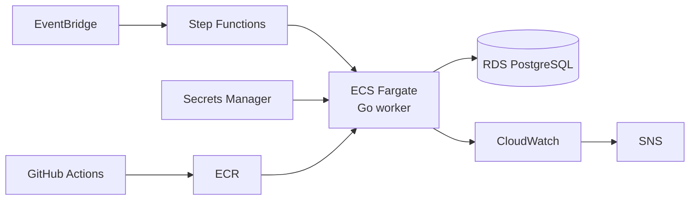

# Supplier Catalog Sync

This command-line application keeps a durable local copy of a fictional supplier catalog. It imports revisioned product batches, records an audit trail of changes and issues, and safely resumes interrupted updates. Withdrawn products remain as tombstones so stale data cannot bring them back. No live supplier or network service is used.

## Run it

Go 1.22 or newer is required. Build and test:

```sh
go test -count=1 ./...
go vet ./...
go build -o catalog ./cmd/catalog
```

The common `--db` flag goes before the command. Prices are stored in cents and displayed as decimal currency values.

Normal import:

```sh
./catalog --db catalog.json start --file testdata/happy.json
./catalog --db catalog.json status
./catalog --db catalog.json report
./catalog --db catalog.json products
```

Simulated supplier outage, followed by a resume:

```sh
./catalog --db outage.json start --file testdata/happy.json --fail-after 2
./catalog --db outage.json status
./catalog --db outage.json resume
```

Real process exit immediately after batch 2 is durably committed:

```sh
./catalog --db crash.json start --file testdata/happy.json --crash-after 2
./catalog --db crash.json status
./catalog --db crash.json resume
```

Importing the same feed twice is safe:

```sh
./catalog --db repeat.json start --file testdata/happy.json
./catalog --db repeat.json start --file testdata/happy.json
./catalog --db repeat.json products
```

Other assessment scenarios:

```sh
./catalog --db order.json start --file testdata/dup_out_of_order.json
./catalog --db order.json products

./catalog --db bad.json start --file testdata/bad_records.json
./catalog --db bad.json report

./catalog --db missing.json start --file testdata/missing_batch.json
./catalog --db missing.json status
```

Use `report --run N` for an older run, `products --status active` to filter products, or `abort` to close an interrupted run while retaining completed batches.

## Design summary

- Supplier revision is the only ordering rule. Older records are ignored; equal revisions with different content become issues.
- Withdrawn products are retained as tombstones. Absence from a feed never deletes a product.
- Each batch uses one atomic JSON commit containing products, changes, issues, counters, and the next-batch cursor. A rename in the same directory makes the file replacement atomic.
- A run is complete only after its cursor proves every declared batch was committed. Partial runs are always shown as incomplete.
- Invalid records do not reject a whole batch; they are retained as issues for staff attention.

## Assumptions

- The supplier assigns increasing revisions independently for each product.
- Money is represented as integer cents; no currency conversion is needed.
- The stored record wins when the same revision has different content, and a conflict is kept for a human.
- Only one application process accesses a database file at a time.
- A run left `running` at startup is treated as a crashed run and can be resumed.
- A malformed feed JSON is rejected before a run is created.
- A feed path remains available and refers to the same logical feed when a run is resumed.

## Unfinished work

- The state is one JSON file loaded fully into memory, so it will not scale. A production version should use PostgreSQL or SQLite with one transaction per batch.
- There is no locking for concurrent processes.
- There is no real HTTP supplier client with retry and backoff.
- There is no manual issue resolution or issue lifecycle across runs.
- There is no scheduling or notification system.
- There is no authentication or authorization.

## Production on AWS (not implemented)

EventBridge would start a Step Functions workflow that runs the Go worker on ECS Fargate. The worker would use RDS PostgreSQL for transactional state and Secrets Manager for credentials. CloudWatch would collect logs and metrics, with SNS notifying staff of failures or unresolved issues. GitHub Actions would build and publish the container to ECR.



## AI usage

TODO: Replace this line with your own AI usage disclosure.
